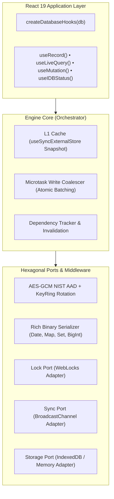

<div align="center">

# ⚡ use-idb

**Resilient, High-Performance Reactive IndexedDB State Engine for React 19 & TypeScript.**  
_Zero external runtime dependencies • Pragmatic Hexagonal Core • Sub-3kB min+gzip_

[](https://github.com/inevitableDivu/use-idb)
[](https://www.typescriptlang.org/)
[](https://react.dev/)
[](https://github.com/inevitableDivu/use-idb)
[](https://bundlephobia.com)
[](https://opensource.org/licenses/MIT)

[Features](#-key-features) • [Architecture](#-architecture) • [Getting Started](#-getting-started) • [Fluent Query Engine](#-fluent-query-engine-enginequery) • [React Hooks API](#-react-hooks-api) • [Security & Encryption](#-security--field-level-encryption) • [Benchmarks](#-performance-guarantees)

</div>

---

## 💡 Why `use-idb`?

Existing IndexedDB wrappers either act as raw Promise bridges (`idb`, `idb-keyval`) without UI reactivity, or bloat your client bundle with large ORMs that suffer from **React 19 Concurrent Mode tearing**, **cross-tab version deadlocks**, and **uncoordinated write bottlenecks**.

`use-idb` was architected from the ground up for high-scale, offline-first web applications. It pairs a **Pragmatic Hexagonal storage core** with an **in-memory L1 synchronous cache**, **microtask write coalescing**, **NIST SP 800-38D context-bound AES-GCM encryption**, and seamless **React 19 `<Suspense>`** integration.

---

## 🚀 Key Features

- **⚡ Microtask Write Coalescer**: Coalesces concurrent writes in the same event tick into a single atomic IndexedDB batch. Reduces disk I/O and transaction thrashing by up to 90%.
- **🔄 L1 Synchronous Memory Cache**: Completely avoids React 19 UI tearing and suspense flickers using `useSyncExternalStore` backed by referentially stable snapshots.
- **🛡️ NIST SP 800-38D AES-GCM Encryption**: Zero-dependency field-level encryption with context-bound Authenticated Additional Data (`v1:store:key:fieldPath`), preventing cross-record and cross-store ciphertext transposition attacks.
- **🔑 Pluggable KeyRing & Key Rotation**: Seamless cryptographic key migration without service disruption or manual table rewrites.
- **📦 Rich Zero-Dependency Serialization**: Native preservation of `Date`, `BigInt`, `Uint8Array`, `Map`, and `Set` across storage and encryption boundaries.
- **🌐 Real-Time Cross-Tab Sync**: Synchronizes mutations instantly across browser tabs via strict schema-validated `BroadcastChannel` envelopes.
- **🔒 WebLocks Upgrade Coordination**: Prevents multi-tab connection deadlocks and version upgrade blocks using `navigator.locks` exclusivity and graceful connection teardown.
- **🎯 End-to-End Type Inference**: `store<T>()` carries model, primary-key, index, query, CRUD, and React hook types from the config literal.
- **⏳ Native React 19 Suspense**: First-class render-phase promise throwing with zero flickering during query refetches.
- **🪶 Ultra-Lightweight & Modular**: Subpath exports (`use-idb`, `use-idb/react`, `use-idb/core`) with `"sideEffects": false` for optimal tree-shaking (~2.0 kB min+gzip core).

---

## 🏛️ Architecture

`use-idb` implements a **Pragmatic Hexagonal Architecture** separating domain synchronization and caching from browser storage ports.



---

## 📦 Installation

```bash
pnpm add use-idb
# or
npm install use-idb
# or
yarn add use-idb
```

---

## 🛠️ Getting Started

### 1. Rapid Prototyping (Zero Configuration)

Need a fast, reactive key-value store with no boilerplate? Use `useIdb` directly:

```tsx
import { useIdb } from "use-idb";

function ThemeToggle() {
  const { value: theme, setValue: setTheme } = useIdb<"light" | "dark">("app-theme", {
    defaultValue: "light",
  });

  return (
    <button onClick={() => setTheme(theme === "light" ? "dark" : "light")}>
      Current Theme: {theme}
    </button>
  );
}
```

---

### 2. Inferred Store Definitions & Hook Factory (Recommended)

Declare each model once in the runtime config. Store names, model fields, keys, index values, query results, and bound React hooks are inferred from that declaration:

```tsx
import { createDatabase, createDatabaseHooks, store } from "use-idb";

// 1. Define Entity Models
export interface User {
  id: string;
  name: string;
  email: string;
  role: "admin" | "user";
  createdAt: Date;
}

// 2. Configure stores and initialize the database. `store<User>()` preserves
//    the model fields, the inferred string key, and literal index names.
export const db = createDatabase({
  name: "app-db",
  version: 1,
  stores: {
    users: store<User>()({
      keyPath: "id",
      indexes: {
        by_role: "role",
        by_email: { keyPath: "email", unique: true },
      },
    }),
  },
});

// 3. The database instance supplies all type information to its hooks.
export const { useRecord, useLiveQuery, useMutation, useIDBStatus } = createDatabaseHooks(db);
```

For a common single-field `id` key, the direct call form is also available:

```ts
products: store<Product>({
  keyPath: "id",
  indexes: { by_name: "name" },
});
```

### Practical examples

The [`examples/`](./examples/) folder contains ten end-to-end starting points:
typed CRUD and queries, reactive React lists, multi-entry indexes, offline
sync, compound keys, schema migrations, atomic multi-store transactions,
encrypted fields, cross-tab updates, and bulk backup/restore. See the
[examples guide](./examples/README.md) for setup and security notes.

Use the curried form when you want exact literal index-name inference or a custom/compound key path:

```ts
memberships: store<Membership>()({ keyPath: ["organizationId", "memberId"] });
```

This is a breaking change from manually authored `DatabaseSchema` interfaces; update existing configs to use typed stores. The optional `db.from("users")`/`db.table("users")` accessor is not part of this API.

---

## 🔍 Fluent Query Engine (`engine.query`)

The core engine features a type-safe, fluent query builder that compiles down to native `IDBIndex`, `IDBKeyRange`, and zero-allocation `IDBCursor` advances.

```typescript
const query = db.query("users");
```

### 1. Indexed Lookups & Key Ranges

Chain `.where(indexName)` with native key range operations:

```typescript
// Exact key match on an index (IDBKeyRange.only)
const admins = await db.query("users").where("role").equals("admin").toArray();

// Bounded range query (IDBKeyRange.bound)
// between(lower, upper, lowerOpen?, upperOpen?)
const youngAdults = await db.query("users").where("age").between(18, 30).toArray();

// Open-ended lower bound (IDBKeyRange.lowerBound)
const seniors = await db.query("users").where("age").above(65).toArray();

// Open-ended upper bound (IDBKeyRange.upperBound)
const minors = await db.query("users").where("age").below(18).toArray();
```

### 2. Cursor Sorting, Ordering & Unique Keys

Control direction using IndexedDB cursor modes:

```typescript
// Traverse descending (reverse chronological order)
const latestLogins = await db
  .query("users")
  .where("lastLogin")
  .direction("prev")
  .limit(10)
  .toArray();

// Retrieve distinct values using "nextunique" or "prevunique"
const uniqueRoles = await db.query("users").where("role").direction("nextunique").toArray();
```

### 3. Pagination with Zero-Allocation Skip (`offset` & `limit`)

Avoid reading unused records into JavaScript memory. `offset(n)` uses native `cursor.advance(n)` to skip directly to the target record before fetching:

```typescript
function getPage(pageNumber: number, pageSize: number = 20) {
  return db
    .query("users")
    .where("role")
    .equals("customer")
    .offset((pageNumber - 1) * pageSize)
    .limit(pageSize)
    .toArray();
}
```

### 4. High-Speed Native Counts vs. Filtered Counts

- When no JavaScript filter is applied, `.count()` automatically uses native `IDBIndex.count()` or `IDBObjectStore.count()` without iterating over records or allocating memory.
- When an in-memory `.filter()` is applied, it streams records through the predicate:

```typescript
// Fast-path: Native IDB count (0ms overhead)
const totalAdmins = await db.query("users").where("role").equals("admin").count();

// Post-cursor in-memory JavaScript filter
const verifiedAdmins = await db
  .query("users")
  .where("role")
  .equals("admin")
  .filter((user) => user.email.endsWith("@company.com"))
  .count();
```

### 5. Fetch Single Match (`first()`)

Retrieves the first matching record or `undefined`:

```typescript
const primaryAdmin = await db.query("users").where("role").equals("admin").first();
```

---

## 📖 React Hooks API

`use-idb` provides both zero-config standalone hooks and factory-generated schema-bound hooks.

### 1. Single Record Management (`useRecord`)

Synchronous read backed by L1 memory cache, optimistic write overlays, and partial shallow patches:

```tsx
function UserCard({ userId }: { userId: string }) {
  const { data: user, isLoading, isFetching, patch, set, remove } = useRecord("users", userId);

  if (isLoading) return <div>Loading user...</div>;
  if (!user) return <div>User not found</div>;

  return (
    <div>
      <h3>
        {user.name} ({user.role})
      </h3>
      {/* Shallow patch updates only specified keys */}
      <button onClick={() => patch({ role: "admin" })}>Promote to Admin</button>
      {/* Full update replaces record */}
      <button onClick={() => set({ ...user, name: "New Name" })}>Rename</button>
      {/* Deletes record from IDB and cache */}
      <button onClick={() => remove()}>Delete User</button>
    </div>
  );
}
```

### 2. Auto-Subscribing Queries (`useLiveQuery`)

Live queries track dependencies automatically. Whenever matching keys or stores mutate (locally or in another browser tab), `useSyncExternalStore` triggers an instant, tear-free re-render:

```tsx
function FilteredUserList({ minAge }: { minAge: number }) {
  // Pass dependency array to re-run query when parameters change
  const {
    data: users = [],
    isLoading,
    isFetching,
    refetch,
  } = useLiveQuery(
    (engine) => engine.query("users").where("age").above(minAge).toArray(),
    [minAge],
  );

  return (
    <div>
      <button onClick={() => refetch()}>Force Refresh</button>
      <ul>
        {users.map((u) => (
          <li key={u.id}>
            {u.name} — Age {u.age}
          </li>
        ))}
      </ul>
    </div>
  );
}
```

### 3. React 19 `<Suspense>` Mode

Eliminate loading boilerplate by enabling native React 19 Suspense contracts:

```tsx
function SuspendedUserList() {
  const { data: users } = useLiveQuery((engine) => engine.query("users").toArray(), [], {
    suspense: true,
  });

  return (
    <ul>
      {users.map((u) => (
        <li key={u.id}>{u.name}</li>
      ))}
    </ul>
  );
}

// In parent tree:
<Suspense fallback={<SkeletonLoader />}>
  <SuspendedUserList />
</Suspense>;
```

### 4. Mutations & Cross-Store Atomic Transactions (`useMutation`)

Execute concurrent mutations without transaction conflicts. Multiple writes inside the same tick are automatically coalesced:

```tsx
function BulkImportButton() {
  const { put, bulkPut, remove, clearStore, transaction, isPending, error } = useMutation("users");

  const handleImport = async (records: User[]) => {
    // Coalesced into non-blocking chunked writes
    await bulkPut(records.map((user) => ({ key: user.id, value: user })));
  };

  const handleDelete = async (userId: string) => {
    await remove(userId);
  };

  const handleAtomicTransfer = async () => {
    // Cross-store atomic ACID transaction with rollback on throw
    await transaction(["users", "audit_logs"], "readwrite", async (tx) => {
      const user = await tx.get<User>("users", "u_1");
      if (user) {
        await tx.put("audit_logs", { event: "MODIFIED", user: user.id, at: Date.now() });
      }
    });
  };

  return (
    <div>
      {error && <p className="error">Mutation failed: {error.message}</p>}
      <button disabled={isPending} onClick={handleAtomicTransfer}>
        {isPending ? "Executing..." : "Run Atomic Transfer"}
      </button>
    </div>
  );
}
```

### 5. Telemetry & Connection Lifecycle (`useIDBStatus`)

Exposes real-time connection state, storage quota, and graceful downgrade detection (e.g. private browsing mode):

```tsx
function StorageTelemetryBanner() {
  const {
    connectionState, // "CONNECTING" | "OPEN" | "CLOSING" | "CLOSED" | "BLOCKED" | "CORRUPTED"
    isFallbackMode, // true if running on in-memory storage fallback
    isUpgradeBlocked, // true if another tab is blocking schema upgrade
    requiresReloadForUpgrade, // true if another tab upgraded schema and connection was released
    quota, // { usageBytes, quotaBytes, percentUsed, isPersisted }
    reconnect, // recovery callback to cleanly re-establish connection
  } = useIDBStatus();

  return (
    <aside>
      <span>Status: {connectionState}</span>
      {isFallbackMode && <span>⚠️ Private mode: in-memory fallback active</span>}
      {isUpgradeBlocked && <span>⚠️ Please close other tabs to complete database upgrade</span>}
      {requiresReloadForUpgrade && (
        <button onClick={() => window.location.reload()}>Reload App</button>
      )}
      {quota.percentUsed != null && <span>Storage: {quota.percentUsed.toFixed(1)}% used</span>}
    </aside>
  );
}
```

### 6. React Context Architecture (`IndexedDBProvider`)

Optionally inject a shared engine instance throughout your component tree:

```tsx
import { IndexedDBProvider, createDatabase } from "use-idb";

const db = createDatabase({
  name: "custom-db",
  version: 1,
  stores: { items: { keyPath: "id" } },
});

export function App() {
  return (
    <IndexedDBProvider client={db}>
      <YourApplication />
    </IndexedDBProvider>
  );
}
```

---

## 🔐 Security & Field-Level Encryption

`use-idb` provides field-level AES-GCM hardware-accelerated encryption using WebCrypto with zero runtime dependencies.

### Transposition Defense (NIST SP 800-38D AAD)

Plain AES-GCM allows an attacker with IndexedDB access to swap encrypted payloads between rows or stores. When a primary key is known before encryption, `use-idb` binds Authenticated Additional Data (`v1:storeName:key:fieldPath`) to each encryption tag, so moving ciphertext to another store, key, or field fails authentication. Envelopes include `keyBound` to record whether the primary key was available. If a write has no key yet (for example, an auto-generated key whose value is created by IndexedDB), the middleware uses `*` for the key component; that preserves readability but does **not** prevent ciphertext from being moved between records in the same store. Use an inline key path or pass an explicit key to `put` when per-record transposition protection is required. Older envelopes without `keyBound` remain readable through a legacy compatibility fallback.

```tsx
import { createDatabase, createEncryptionMiddleware } from "use-idb";

// Generate or import CryptoKey
const key = await crypto.subtle.generateKey({ name: "AES-GCM", length: 256 }, true, [
  "encrypt",
  "decrypt",
]);

const encryption = createEncryptionMiddleware(
  key,
  // Dotted nested paths are automatically resolved and encrypted in-place
  ["profile.ssn", "financial.creditCard"],
);

const db = createDatabase(schema, {
  middlewares: [encryption],
});
```

### Zero-Downtime Key Rotation (`KeyRing`)

Rotate encryption keys on live clients without table rewrites:

```tsx
const encryption = createEncryptionMiddleware(
  {
    primaryKeyId: "v2", // All writes encrypted with v2
    keys: {
      v1: legacyKey, // Legacy reads decrypted seamlessly with v1
      v2: currentKey,
    },
  },
  ["secret"],
);
```

---

## ⚡ Performance Guarantees

| Architecture Component       | Traditional IDB Hooks                    | `use-idb` Engine                                                |
| ---------------------------- | ---------------------------------------- | --------------------------------------------------------------- |
| **Write Thrashing**          | 1 IDB Transaction per operation          | **Microtask Coalesced Batching** (up to 90% fewer transactions) |
| **Read Latency**             | Async disk roundtrip on every render     | **Sync L1 Cache Hit** (0ms latency, zero tearing)               |
| **Bundle Footprint**         | 15 kB – 50 kB+ (Dexie, RxDB)             | **~2.0 kB min+gzip** (zero dependencies)                        |
| **React 19 Concurrent Mode** | Tearing risks with `useState`            | **100% `useSyncExternalStore` verified**                        |
| **Security Validation**      | Plaintext or unauthenticated ciphertexts | **NIST SP 800-38D AAD binding & KeyRing rotation**              |

---

## 🧪 Rigorous Verification & Chaos Testing

Run `pnpm release:check` before cutting a release to run typechecking, lint,
tests, the package build, and formatting checks. Use `pnpm release:dry-run` to
also preview the files included by `pnpm pack`.

Label each merged feature PR with exactly one of `release:patch`,
`release:minor`, or `release:major` to have automation open or update a version
bump PR. The version PR is opened using `GITHUB_TOKEN`; after it is reviewed
and merged, manually create and push its matching `vMAJOR.MINOR.PATCH` tag to
start the [npm publish workflow](./.github/workflows/publish.yml), which
verifies the tag against `package.json` before publishing. For version
`1.2.3`, run `git tag v1.2.3 && git push origin v1.2.3`. Create those three
labels in GitHub first; PRs without a release label do not schedule a release.
Generated release PRs use the
[release checklist template](./.github/PULL_REQUEST_TEMPLATE/release.md).
Before publishing, configure npm trusted publishing for this GitHub repository
and the exact workflow file `.github/workflows/publish.yml`. The workflow
publishes with provenance and does not require a long-lived npm token.

- **32 Automated Tests** covering cryptographic transposition attacks, WebLocks upgrade exclusivity, zombie read eviction, optimistic rollback stacks, and React Suspense integration.
- **Type-Aware Static Analysis** with `oxlint` and strict TypeScript compilation (`tsc --noEmit`).

```bash
# Run test suite
pnpm test

# Run strict type checking
pnpm typecheck

# Run linter
pnpm lint
```

---

## 📄 License

MIT © [Divyansh Pandey](https://github.com/inevitableDivu)
