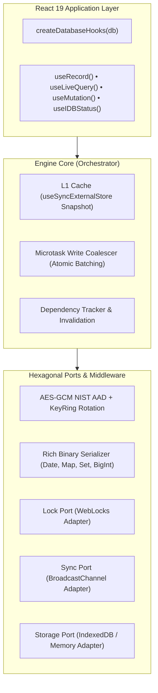

<div align="center">

# ⚡ use-idb

**Reactive, typed IndexedDB storage for React 18+ and TypeScript.**  
_Small runtime surface • Typed schemas • React external-store integration_

[](https://github.com/inevitableDivu/use-idb/actions/workflows/ci.yml)
[](https://www.typescriptlang.org/)
[](https://react.dev/)
[](https://github.com/inevitableDivu/use-idb)
[](https://opensource.org/licenses/MIT)

[Features](#-key-features) • [Architecture](#-architecture) • [Getting Started](#-getting-started) • [Fluent Query Engine](#-fluent-query-engine-enginequery) • [React Hooks API](#-react-hooks-api) • [Security & Encryption](#-security--field-level-encryption) • [Performance characteristics](#-performance-characteristics)

</div>

---

## 💡 Why `use-idb`?

`use-idb` combines a typed IndexedDB API with React subscriptions so applications can read persisted records reactively without managing a separate state cache and invalidation layer.

The package pairs a storage-adapter core with a synchronous L1 snapshot cache, microtask write coalescing, optional AES-GCM field encryption, and React Suspense integration. It provides local persistence and cross-tab invalidation; application-level offline synchronization and conflict resolution remain the application’s responsibility.

---

## 🚀 Key Features

- **⚡ Microtask Write Coalescer**: Coalesces compatible queued writes per object store into atomic IndexedDB batches. Actual throughput gains depend on workload and browser.
- **🔄 L1 Synchronous Memory Cache**: Provides stable synchronous snapshots through `useSyncExternalStore`, designed to work with concurrent React rendering.
- **🛡️ AES-GCM Field Encryption**: Optional field-level encryption with authenticated additional data that binds ciphertext to its store, field, and primary key when the key is available.
- **🔑 Pluggable KeyRing**: Keep prior keys for reading old ciphertext while selecting a new primary key for future writes; existing data is re-encrypted only when rewritten.
- **📦 Rich Serialization**: The built-in versioned serializer supports `Date`, `BigInt`, `ArrayBuffer`, typed arrays, `DataView`, `Map`, `Set`, `undefined`, and special numeric values.
- **🌐 Cross-Tab Invalidation**: Broadcasts versioned invalidation hints via `BroadcastChannel`; receiving tabs re-read their own IndexedDB database.
- **🔒 WebLocks Upgrade Coordination**: Uses `navigator.locks` when available to coordinate database opening and schema upgrades, with a no-op adapter where unsupported.
- **🎯 End-to-End Type Inference**: `store<T>()` carries model, primary-key, index, query, CRUD, and React hook types from the config literal.
- **⏳ Suspense Integration**: `useLiveQuery` can suspend while its initial query is loading, with data snapshots still exposed through the regular hook contract.
- **🪶 Modular Package Exports**: Root, React, and core subpath exports with `"sideEffects": false` to support tree-shaking.

---

## 🏛️ Architecture

`use-idb` implements a **Pragmatic Hexagonal Architecture** separating domain synchronization and caching from browser storage ports.



---

## 📦 Installation

```bash
pnpm add @inevitable_divu/use-idb
# or
npm install @inevitable_divu/use-idb
# or
yarn add @inevitable_divu/use-idb
```

---

## 🛠️ Getting Started

### 1. Rapid Prototyping (Zero Configuration)

Need a fast, reactive key-value store with no boilerplate? Use `useIdb` directly:

```tsx
import { useIdb } from "@inevitable_divu/use-idb";

function ThemeToggle() {
  const { value: theme, setValue: setTheme } = useIdb<"light" | "dark">("app-theme", {
    defaultValue: "light",
  });

  return (
    <button onClick={() => setTheme(theme === "light" ? "dark" : "light")}>
      Current Theme: {theme}
    </button>
  );
}
```

---

### 2. Inferred Store Definitions & Hook Factory (Recommended)

Declare each model once in the runtime config. Store names, model fields, keys, index values, query results, and bound React hooks are inferred from that declaration:

```tsx
import { createDatabase, createDatabaseHooks, store } from "@inevitable_divu/use-idb";

// 1. Define Entity Models
export interface User {
  id: string;
  name: string;
  email: string;
  role: "admin" | "user";
  createdAt: Date;
}

// 2. Configure stores and initialize the database. `store<User>()` preserves
//    the model fields, the inferred string key, and literal index names.
export const db = createDatabase({
  name: "app-db",
  version: 1,
  stores: {
    users: store<User>()({
      keyPath: "id",
      indexes: {
        by_role: "role",
        by_email: { keyPath: "email", unique: true },
      },
    }),
  },
});

// 3. The database instance supplies all type information to its hooks.
export const { useRecord, useLiveQuery, useMutation, useIDBStatus } = createDatabaseHooks(db);
```

For a common single-field `id` key, the direct call form is also available:

```ts
products: store<Product>({
  keyPath: "id",
  indexes: { by_name: "name" },
});
```

### Practical examples

The [`examples/`](./examples/) folder contains ten end-to-end starting points:
typed CRUD and queries, reactive React lists, multi-entry indexes, offline
sync, compound keys, schema migrations, atomic multi-store transactions,
encrypted fields, cross-tab updates, and bulk backup/restore. See the
[examples guide](./examples/README.md) for setup and security notes.

Use the curried form when you want exact literal index-name inference or a custom/compound key path:

```ts
memberships: store<Membership>()({ keyPath: ["organizationId", "memberId"] });
```

This is a breaking change from manually authored `DatabaseSchema` interfaces; update existing configs to use typed stores. The optional `db.from("users")`/`db.table("users")` accessor is not part of this API.

---

## 🔍 Fluent Query Engine (`engine.query`)

The core engine features a type-safe, fluent query builder that compiles down to native `IDBIndex`, `IDBKeyRange`, and zero-allocation `IDBCursor` advances.

```typescript
const query = db.query("users");
```

### 1. Indexed Lookups & Key Ranges

Chain `.where(indexName)` with native key range operations:

```typescript
// Exact key match on an index (IDBKeyRange.only)
const admins = await db.query("users").where("role").equals("admin").toArray();

// Bounded range query (IDBKeyRange.bound)
// between(lower, upper, lowerOpen?, upperOpen?)
const youngAdults = await db.query("users").where("age").between(18, 30).toArray();

// Open-ended lower bound (IDBKeyRange.lowerBound)
const seniors = await db.query("users").where("age").above(65).toArray();

// Open-ended upper bound (IDBKeyRange.upperBound)
const minors = await db.query("users").where("age").below(18).toArray();
```

### 2. Cursor Sorting, Ordering & Unique Keys

Control direction using IndexedDB cursor modes:

```typescript
// Traverse descending (reverse chronological order)
const latestLogins = await db
  .query("users")
  .where("lastLogin")
  .direction("prev")
  .limit(10)
  .toArray();

// Retrieve distinct values using "nextunique" or "prevunique"
const uniqueRoles = await db.query("users").where("role").direction("nextunique").toArray();
```

### 3. Pagination with Zero-Allocation Skip (`offset` & `limit`)

Avoid reading unused records into JavaScript memory. `offset(n)` uses native `cursor.advance(n)` to skip directly to the target record before fetching:

```typescript
function getPage(pageNumber: number, pageSize: number = 20) {
  return db
    .query("users")
    .where("role")
    .equals("customer")
    .offset((pageNumber - 1) * pageSize)
    .limit(pageSize)
    .toArray();
}
```

### 4. High-Speed Native Counts vs. Filtered Counts

- When no JavaScript filter is applied, `.count()` automatically uses native `IDBIndex.count()` or `IDBObjectStore.count()` without iterating over records or allocating memory.
- When an in-memory `.filter()` is applied, it streams records through the predicate:

```typescript
// Fast-path: Native IDB count (0ms overhead)
const totalAdmins = await db.query("users").where("role").equals("admin").count();

// Post-cursor in-memory JavaScript filter
const verifiedAdmins = await db
  .query("users")
  .where("role")
  .equals("admin")
  .filter((user) => user.email.endsWith("@company.com"))
  .count();
```

### 5. Fetch Single Match (`first()`)

Retrieves the first matching record or `undefined`:

```typescript
const primaryAdmin = await db.query("users").where("role").equals("admin").first();
```

---

## 📖 React Hooks API

`use-idb` provides both zero-config standalone hooks and factory-generated schema-bound hooks.

### 1. Single Record Management (`useRecord`)

Synchronous read backed by L1 memory cache, optimistic write overlays, and partial shallow patches:

```tsx
function UserCard({ userId }: { userId: string }) {
  const { data: user, isLoading, isFetching, patch, set, remove } = useRecord("users", userId);

  if (isLoading) return <div>Loading user...</div>;
  if (!user) return <div>User not found</div>;

  return (
    <div>
      <h3>
        {user.name} ({user.role})
      </h3>
      {/* Shallow patch updates only specified keys */}
      <button onClick={() => patch({ role: "admin" })}>Promote to Admin</button>
      {/* Full update replaces record */}
      <button onClick={() => set({ ...user, name: "New Name" })}>Rename</button>
      {/* Deletes record from IDB and cache */}
      <button onClick={() => remove()}>Delete User</button>
    </div>
  );
}
```

### 2. Auto-Subscribing Queries (`useLiveQuery`)

Live queries track dependencies automatically. Whenever matching keys or stores mutate (locally or in another browser tab), `useSyncExternalStore` triggers an instant, tear-free re-render:

```tsx
function FilteredUserList({ minAge }: { minAge: number }) {
  // Pass dependency array to re-run query when parameters change
  const {
    data: users = [],
    isLoading,
    isFetching,
    refetch,
  } = useLiveQuery(
    (engine) => engine.query("users").where("age").above(minAge).toArray(),
    [minAge],
  );

  return (
    <div>
      <button onClick={() => refetch()}>Force Refresh</button>
      <ul>
        {users.map((u) => (
          <li key={u.id}>
            {u.name} — Age {u.age}
          </li>
        ))}
      </ul>
    </div>
  );
}
```

### 3. React 19 `<Suspense>` Mode

Eliminate loading boilerplate by enabling native React 19 Suspense contracts:

```tsx
function SuspendedUserList() {
  const { data: users } = useLiveQuery((engine) => engine.query("users").toArray(), [], {
    suspense: true,
  });

  return (
    <ul>
      {users.map((u) => (
        <li key={u.id}>{u.name}</li>
      ))}
    </ul>
  );
}

// In parent tree:
<Suspense fallback={<SkeletonLoader />}>
  <SuspendedUserList />
</Suspense>;
```

### 4. Mutations & Cross-Store Atomic Transactions (`useMutation`)

Execute concurrent mutations without transaction conflicts. Multiple writes inside the same tick are automatically coalesced:

```tsx
function BulkImportButton() {
  const { put, bulkPut, remove, clearStore, transaction, isPending, error } = useMutation("users");

  const handleImport = async (records: User[]) => {
    // Coalesced into non-blocking chunked writes
    await bulkPut(records.map((user) => ({ key: user.id, value: user })));
  };

  const handleDelete = async (userId: string) => {
    await remove(userId);
  };

  const handleAtomicTransfer = async () => {
    // Cross-store atomic ACID transaction with rollback on throw
    await transaction(["users", "audit_logs"], "readwrite", async (tx) => {
      const user = await tx.get<User>("users", "u_1");
      if (user) {
        await tx.put("audit_logs", { event: "MODIFIED", user: user.id, at: Date.now() });
      }
    });
  };

  return (
    <div>
      {error && <p className="error">Mutation failed: {error.message}</p>}
      <button disabled={isPending} onClick={handleAtomicTransfer}>
        {isPending ? "Executing..." : "Run Atomic Transfer"}
      </button>
    </div>
  );
}
```

### 5. Telemetry & Connection Lifecycle (`useIDBStatus`)

Exposes real-time connection state, storage quota, and graceful downgrade detection (e.g. private browsing mode):

```tsx
function StorageTelemetryBanner() {
  const {
    connectionState, // "CONNECTING" | "OPEN" | "CLOSING" | "CLOSED" | "BLOCKED" | "CORRUPTED"
    isFallbackMode, // true if running on in-memory storage fallback
    isUpgradeBlocked, // true if another tab is blocking schema upgrade
    requiresReloadForUpgrade, // true if another tab upgraded schema and connection was released
    quota, // { usageBytes, quotaBytes, percentUsed, isPersisted }
    reconnect, // recovery callback to cleanly re-establish connection
  } = useIDBStatus();

  return (
    <aside>
      <span>Status: {connectionState}</span>
      {isFallbackMode && <span>⚠️ Private mode: in-memory fallback active</span>}
      {isUpgradeBlocked && <span>⚠️ Please close other tabs to complete database upgrade</span>}
      {requiresReloadForUpgrade && (
        <button onClick={() => window.location.reload()}>Reload App</button>
      )}
      {quota.percentUsed != null && <span>Storage: {quota.percentUsed.toFixed(1)}% used</span>}
    </aside>
  );
}
```

### 6. React Context Architecture (`IndexedDBProvider`)

Optionally inject a shared engine instance throughout your component tree:

```tsx
import { IndexedDBProvider, createDatabase } from "@inevitable_divu/use-idb";

const db = createDatabase({
  name: "custom-db",
  version: 1,
  stores: { items: { keyPath: "id" } },
});

export function App() {
  return (
    <IndexedDBProvider client={db}>
      <YourApplication />
    </IndexedDBProvider>
  );
}
```

---

## 🔐 Security & Field-Level Encryption

`use-idb` provides field-level AES-GCM hardware-accelerated encryption using WebCrypto with zero runtime dependencies.

### Transposition Defense (NIST SP 800-38D AAD)

Plain AES-GCM allows an attacker with IndexedDB access to swap encrypted payloads between rows or stores. When a primary key is known before encryption, `use-idb` binds Authenticated Additional Data to each encryption tag, so moving new ciphertext to another store, key, or field fails authentication. New envelopes use a type-tagged canonical key encoding (`aadVersion: 2`) to avoid key-representation collisions, while old envelopes remain readable with the legacy encoding. Existing legacy ciphertext retains the security properties of its original AAD until rewritten. Envelopes include `keyBound` to record whether the primary key was available. If a write has no key yet (for example, an auto-generated key whose value is created by IndexedDB), the middleware uses `*` for the key component; that preserves readability but does **not** prevent ciphertext from being moved between records in the same store. Use an inline key path or pass an explicit key to `put` when per-record transposition protection is required.

```tsx
import { createDatabase, createEncryptionMiddleware } from "@inevitable_divu/use-idb";

// Generate or import CryptoKey
const key = await crypto.subtle.generateKey({ name: "AES-GCM", length: 256 }, true, [
  "encrypt",
  "decrypt",
]);

const encryption = createEncryptionMiddleware(
  key,
  // Dotted nested paths are automatically resolved and encrypted in-place
  ["profile.ssn", "financial.creditCard"],
);

const db = createDatabase(schema, {
  middlewares: [encryption],
});
```

### Zero-Downtime Key Rotation (`KeyRing`)

Rotate encryption keys on live clients without table rewrites:

```tsx
const encryption = createEncryptionMiddleware(
  {
    primaryKeyId: "v2", // All writes encrypted with v2
    keys: {
      v1: legacyKey, // Legacy reads decrypted seamlessly with v1
      v2: currentKey,
    },
  },
  ["secret"],
);
```

---

## ⚡ Performance characteristics

The package is designed to reduce avoidable database work, but performance depends on the browser, dataset, indexes, serialized value sizes, and query shape. The project does not currently publish a reproducible benchmark suite or enforce a bundle-size budget, so the following are implementation characteristics rather than numeric performance guarantees:

| Area | Current design |
| --- | --- |
| Writes | Compatible operations queued within a microtask can share a readwrite transaction. |
| React reads | Stable cache snapshots avoid an asynchronous storage read during every render. |
| Query execution | Indexed ranges and cursor APIs are used where the query plan permits them; JavaScript filters and `orderBy` may scan and sort results in memory. |
| React consistency | Hooks use `useSyncExternalStore` to integrate the cache with React rendering. |
| Encryption | Optional AES-GCM field encryption uses authenticated additional data when a primary key is available. |

---

## 🧪 Rigorous Verification & Chaos Testing

Run `pnpm release:check` before cutting a release to run typechecking, lint,
tests, the package build, and formatting checks. Use `pnpm release:dry-run` to
also preview the files included by `pnpm pack`.

Label each merged feature PR with exactly one of `release:patch`,
`release:minor`, or `release:major` to have automation open or update a version
bump PR. The version PR is opened using `GITHUB_TOKEN`; after it is reviewed
and merged, manually create and push its matching `vMAJOR.MINOR.PATCH` tag to
start the [npm publish workflow](./.github/workflows/publish.yml), which
verifies the tag against `package.json` before publishing. For version
`1.2.3`, run `git tag v1.2.3 && git push origin v1.2.3`. Create those three
labels in GitHub first; PRs without a release label do not schedule a release.
Generated release PRs use the
[release checklist template](./.github/PULL_REQUEST_TEMPLATE/release.md).
Before publishing, configure npm trusted publishing for this GitHub repository
and the exact workflow file `.github/workflows/publish.yml`. The workflow
publishes with provenance and does not require a long-lived npm token.

- **32 Automated Tests** covering cryptographic transposition attacks, WebLocks upgrade exclusivity, zombie read eviction, optimistic rollback stacks, and React Suspense integration.
- **Type-Aware Static Analysis** with `oxlint` and strict TypeScript compilation (`tsc --noEmit`).

```bash
# Run test suite
pnpm test

# Run strict type checking
pnpm typecheck

# Run linter
pnpm lint
```

---


---

## Runtime guarantees and configuration notes

### Schema and runtime configuration

The schema contains durable structure—database name/version, stores, indexes, and migrations. Prefer the grouped runtime API for tuning how the engine runs. The old `schema.options` and `createDatabase(schema, { storage, sync, lock, middlewares })` forms remain supported for compatibility.

```ts
import {
  createDatabase,
  type DatabaseDiagnosticsConfig,
} from "@inevitable_divu/use-idb";

const diagnostics: DatabaseDiagnosticsConfig = {
  onEvent(event) {
    // Send structured events to application telemetry. Record values and keys are never included.
    console.debug("use-idb", event.type, event);
  },
  onError(error, context) {
    console.error("use-idb operation failed", context.operation, error);
  },
};

const db = createDatabase({
  schema,
  adapters: {
    // storage: customStorage,
    // sync: customSync,
    // lock: customLock,
  },
  middleware: [],
  cache: { maxEntries: 1_000, ttlMs: 60_000 },
  writes: { coalesceWindowMs: 0 },
  crossTab: { enabled: true },
  fallback: {
    strategy: "memory", // or "error" to require IndexedDB/custom storage
    requestPersistentStorage: false,
  },
  diagnostics,
});
```

The runtime groups are validated up front. Cache defaults are `maxEntries: 1000` and `ttlMs: 60000`; write coalescing defaults to the current microtask (`coalesceWindowMs: 0`). Active subscriptions may keep the cache above its configured soft capacity.

Fallback is limited to recognized IndexedDB availability/security failures; migration, schema, version, quota, and transaction failures remain visible. Memory storage is volatile and process-local. `requestPersistentStorage` is a best-effort browser request; the grant is browser-controlled and available in `useIDBStatus().persistentStorageGranted`. If `fallback.strategy` is `"error"`, unsupported environments fail rather than silently using memory storage.

Diagnostics are opt-in. Events describe lifecycle and committed-operation metadata, not record payloads or keys. Event/error callbacks are best-effort: exceptions thrown by telemetry callbacks are swallowed so they cannot change the outcome of a storage operation.


### Typed out-of-line primary keys

For records whose primary key is stored separately from the record value, use `outOfLineStore` to preserve key, record, and index types:

```ts
import { createDatabase, outOfLineStore } from "@inevitable_divu/use-idb";

interface AuditEvent {
  type: "created" | "updated";
  occurredAt: Date;
}

const db = createDatabase({
  name: "audit-db",
  version: 1,
  stores: {
    events: outOfLineStore<AuditEvent, string>()({
      indexes: { by_type: "type" },
    }),
  },
});

await db.put("events", { type: "created", occurredAt: new Date() }, "event-1");
const event = await db.get("events", "event-1");
```

For records without middleware, `db.update(storeName, key, updater)` performs a synchronous update inside a short readwrite transaction. The updater must be synchronous and side-effect-free because the transaction can abort. This helper is intentionally unavailable when middleware is configured; use the middleware-aware CRUD/batch path instead.

Changing a store's primary `keyPath` or `autoIncrement` setting is not an in-place schema edit. Add a synchronous migration for the target database version that rebuilds the store and copies its data; the engine reports a `DatabaseMigrationError` if the schema changes without such a migration.

### Memory storage is volatile

The memory adapter is process-local and non-durable. It supports staged atomic transactions, clone isolation, configured inline key paths, and unique indexes when the engine supplies a schema, but it cannot share its underlying data across browser tabs or survive a reload. Cross-tab invalidation is disabled when IndexedDB falls back to memory. Applications should check `useIDBStatus().isFallbackMode` and `fallbackReason` before assuming writes are persistent.

### Explicit transactions and middleware

Explicit `db.transaction()` calls are intentionally rejected when middleware is configured. Async middleware such as WebCrypto encryption cannot safely be awaited at arbitrary points inside an active IndexedDB transaction, and silently bypassing middleware would be unsafe. In this configuration, use the regular `get`/`put`/`delete`/batch APIs or restructure the operation so middleware is not required.

IndexedDB transactions are short-lived. Within the callback, await operations belonging to the transaction; do not wait for network requests, timers, or unrelated asynchronous tasks before issuing more transaction requests. A write promise resolves only after its storage transaction commits. If a transaction aborts, the operation rejects and committed cache state is not published.

### Cross-tab notifications

Cross-tab messages are versioned, validated invalidation notifications—not a durable replication log. Receivers refresh data from their own IndexedDB database. They do not transfer records or resolve multi-writer conflicts. Cross-tab sync is disabled when the engine switches to isolated in-memory storage.

### Live query callbacks

A `useLiveQuery` callback is inspected to discover query dependencies and can be invoked again to fetch results. Keep it pure: it should describe a query, not perform writes, emit analytics, or cause external side effects. Supply `queryKey` when closure state affects the query result and cannot be fully represented by the supplied dependency list. Async custom query work may accept the optional second argument `({ signal })`; the signal is aborted when the query is superseded or its hook unmounts. Use it with `fetch` or other cancellable APIs to avoid wasted work.

For diagnostics, provide `diagnostics: { onEvent, onError }` in the runtime configuration. For query performance investigations, call `db.query("store").where("index").equals(value).explain()` to inspect the selected access path, post-filter/sort behavior, and pagination strategy.

## 📄 License

MIT © [Divyansh Pandey](https://github.com/inevitableDivu)
