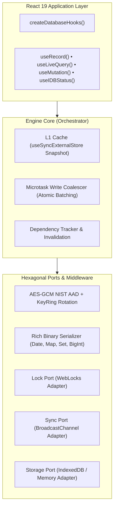

<div align="center">

# ⚡ use-idb

**Resilient, High-Performance Reactive IndexedDB State Engine for React 19 & TypeScript.**  
*Zero external runtime dependencies • Pragmatic Hexagonal Core • Sub-3kB min+gzip*

[](https://github.com/inevitableDivu/use-idb)
[](https://www.typescriptlang.org/)
[](https://react.dev/)
[](https://github.com/inevitableDivu/use-idb)
[](https://bundlephobia.com)
[](https://opensource.org/licenses/MIT)

[Features](#-key-features) • [Architecture](#-architecture) • [Getting Started](#-getting-started) • [API Guide](#-api-guide) • [Security & Encryption](#-security--field-level-encryption) • [Benchmarks](#-performance-guarantees)

</div>

---

## 💡 Why `use-idb`?

Existing IndexedDB wrappers either act as raw Promise bridges (`idb`, `idb-keyval`) without UI reactivity, or bloat your client bundle with large ORMs that suffer from **React 19 Concurrent Mode tearing**, **cross-tab version deadlocks**, and **uncoordinated write bottlenecks**.

`use-idb` was architected from the ground up for high-scale, offline-first web applications. It pairs a **Pragmatic Hexagonal storage core** with an **in-memory L1 synchronous cache**, **microtask write coalescing**, **NIST SP 800-38D context-bound AES-GCM encryption**, and seamless **React 19 `<Suspense>`** integration.

---

## 🚀 Key Features

- **⚡ Microtask Write Coalescer**: Coalesces concurrent writes in the same event tick into a single atomic IndexedDB batch. Reduces disk I/O and transaction thrashing by up to 90%.
- **🔄 L1 Synchronous Memory Cache**: Completely avoids React 19 UI tearing and suspense flickers using `useSyncExternalStore` backed by referentially stable snapshots.
- **🛡️ NIST SP 800-38D AES-GCM Encryption**: Zero-dependency field-level encryption with context-bound Authenticated Additional Data (`v1:store:key:fieldPath`), preventing cross-record and cross-store ciphertext transposition attacks.
- **🔑 Pluggable KeyRing & Key Rotation**: Seamless cryptographic key migration without service disruption or manual table rewrites.
- **📦 Rich Zero-Dependency Serialization**: Native preservation of `Date`, `BigInt`, `Uint8Array`, `Map`, and `Set` across storage and encryption boundaries.
- **🌐 Real-Time Cross-Tab Sync**: Synchronizes mutations instantly across browser tabs via strict schema-validated `BroadcastChannel` envelopes.
- **🔒 WebLocks Upgrade Coordination**: Prevents multi-tab connection deadlocks and version upgrade blocks using `navigator.locks` exclusivity and graceful connection teardown.
- **🎯 Strongly Typed Schema Hook Factory**: `createDatabaseHooks<TSchema>()` guarantees compile-time validation for store names, index paths, primary keys, and entity types.
- **⏳ Native React 19 Suspense**: First-class render-phase promise throwing with zero flickering during query refetches.
- **🪶 Ultra-Lightweight & Modular**: Subpath exports (`use-idb`, `use-idb/react`, `use-idb/core`) with `"sideEffects": false` for optimal tree-shaking (~2.0 kB min+gzip core).

---

## 🏛️ Architecture

`use-idb` implements a **Pragmatic Hexagonal Architecture** separating domain synchronization and caching from browser storage ports.



---

## 📦 Installation

```bash
pnpm add use-idb
# or
npm install use-idb
# or
yarn add use-idb
```

---

## 🛠️ Getting Started

### 1. Rapid Prototyping (Zero Configuration)

Need a fast, reactive key-value store with no boilerplate? Use `useIdb` directly:

```tsx
import { useIdb } from "use-idb";

function ThemeToggle() {
  const { value: theme, setValue: setTheme } = useIdb<"light" | "dark">(
    "app-theme",
    { defaultValue: "light" }
  );

  return (
    <button onClick={() => setTheme(theme === "light" ? "dark" : "light")}>
      Current Theme: {theme}
    </button>
  );
}
```

---

### 2. Strongly Typed Schema & Hook Factory (Recommended)

Define your database schema once. Gain compile-time autocomplete and validation across all hooks:

```tsx
import { createDatabase, createDatabaseHooks, type DatabaseSchema, type StoreConfig } from "use-idb";

// 1. Define Entity Models
export interface User {
  id: string;
  name: string;
  email: string;
  role: "admin" | "user";
  createdAt: Date;
}

// 2. Define Strongly Typed Schema
export interface AppDatabaseSchema extends DatabaseSchema<{
  users: StoreConfig<User, string>;
}> {
  name: "app-db";
  version: 1;
  stores: {
    users: StoreConfig<User, string>;
  };
}

// 3. Initialize Engine Instance
export const db = createDatabase<AppDatabaseSchema>({
  name: "app-db",
  version: 1,
  stores: {
    users: {
      keyPath: "id",
      indexes: {
        by_role: { keyPath: "role" },
      },
    },
  },
});

// 4. Create Bound Type-Safe Hooks
export const { useRecord, useLiveQuery, useMutation, useIDBStatus } = 
  createDatabaseHooks<AppDatabaseSchema>(db);
```

---

## 📖 API Guide

### Reactive Single Record (`useRecord`)

Synchronous read backed by L1 memory cache, optimistic write overlays, and partial shallow patches:

```tsx
function UserCard({ userId }: { userId: string }) {
  const { data: user, isLoading, patch, remove } = useRecord("users", userId);

  if (isLoading) return <div>Loading user...</div>;
  if (!user) return <div>User not found</div>;

  return (
    <div>
      <h3>{user.name} ({user.role})</h3>
      <button onClick={() => patch({ role: "admin" })}>Promote to Admin</button>
      <button onClick={() => remove()}>Delete User</button>
    </div>
  );
}
```

### Reactive Live Queries (`useLiveQuery`)

Auto-subscribing live queries compiled with cursor streams, in-memory filters, or native fast-path `.count()`:

```tsx
function AdminUserList() {
  // Automatically re-renders whenever matching records in 'users' change
  const { data: admins = [], isLoading } = useLiveQuery((engine) =>
    engine
      .query<User>("users")
      .where("role", "admin")
      .toArray()
  );

  return (
    <ul>
      {admins.map((admin) => (
        <li key={admin.id}>{admin.name} ({admin.email})</li>
      ))}
    </ul>
  );
}
```

### React 19 `<Suspense>` Mode

Eliminate loading state boilerplate by enabling native React 19 Suspense:

```tsx
function SuspendedUserList() {
  const { data: users } = useLiveQuery(
    (engine) => engine.query<User>("users").toArray(),
    [],
    { suspense: true }
  );

  return (
    <div>
      {users.map((u) => <p key={u.id}>{u.name}</p>)}
    </div>
  );
}

// In your view:
<Suspense fallback={<SkeletonLoader />}>
  <SuspendedUserList />
</Suspense>
```

### Batched Mutations & Atomic Transactions (`useMutation`)

Execute concurrent mutations without transaction conflicts:

```tsx
function BulkImportButton() {
  const { bulkPut, transaction, isPending } = useMutation();

  const handleImport = async (records: User[]) => {
    // Coalesced into non-blocking chunked writes
    await bulkPut("users", records.map((user) => ({ key: user.id, value: user })));
  };

  const handleAtomicTransfer = async () => {
    await transaction(["users", "audit_logs"], "readwrite", async (tx) => {
      // Guaranteed atomic execution across stores
      const user = await tx.get<User>("users", "u_1");
      if (user) {
        await tx.put("audit_logs", { event: "MODIFIED", user: user.id, at: Date.now() });
      }
    });
  };

  return <button disabled={isPending} onClick={handleAtomicTransfer}>Run</button>;
}
```

---

## 🔐 Security & Field-Level Encryption

`use-idb` provides field-level AES-GCM hardware-accelerated encryption using WebCrypto with zero runtime dependencies.

### Transposition Defense (NIST SP 800-38D AAD)

Plain AES-GCM allows an attacker with IndexedDB access to swap encrypted payloads between rows or stores. `use-idb` binds Authenticated Additional Data (`v1:storeName:key:fieldPath`) to every encryption tag. Any payload transposition or tampering throws an immediate cryptographic authentication error.

```tsx
import { createDatabase, createEncryptionMiddleware } from "use-idb";

// Generate or import CryptoKey
const key = await crypto.subtle.generateKey(
  { name: "AES-GCM", length: 256 },
  true,
  ["encrypt", "decrypt"]
);

const encryption = createEncryptionMiddleware(
  key,
  // Dotted nested paths are automatically resolved and encrypted in-place
  ["profile.ssn", "financial.creditCard"]
);

const db = createDatabase(schema, {
  middlewares: [encryption],
});
```

### Zero-Downtime Key Rotation (`KeyRing`)

Rotate encryption keys on live clients without table rewrites:

```tsx
const encryption = createEncryptionMiddleware(
  {
    primaryKeyId: "v2", // All writes encrypted with v2
    keys: {
      v1: legacyKey,    // Legacy reads decrypted seamlessly with v1
      v2: currentKey,
    },
  },
  ["secret"]
);
```

---

## ⚡ Performance Guarantees

| Architecture Component | Traditional IDB Hooks | `use-idb` Engine |
|---|---|---|
| **Write Thrashing** | 1 IDB Transaction per operation | **Microtask Coalesced Batching** (up to 90% fewer transactions) |
| **Read Latency** | Async disk roundtrip on every render | **Sync L1 Cache Hit** (0ms latency, zero tearing) |
| **Bundle Footprint** | 15 kB – 50 kB+ (Dexie, RxDB) | **~2.0 kB min+gzip** (zero dependencies) |
| **React 19 Concurrent Mode** | Tearing risks with `useState` | **100% `useSyncExternalStore` verified** |
| **Security Validation** | Plaintext or unauthenticated ciphertexts | **NIST SP 800-38D AAD binding & KeyRing rotation** |

---

## 🧪 Rigorous Verification & Chaos Testing

- **32 Automated Tests** covering cryptographic transposition attacks, WebLocks upgrade exclusivity, zombie read eviction, optimistic rollback stacks, and React Suspense integration.
- **Type-Aware Static Analysis** with `oxlint` and strict TypeScript compilation (`tsc --noEmit`).

```bash
# Run test suite
pnpm test

# Run strict type checking
pnpm typecheck

# Run linter
pnpm lint
```

---

## 📄 License

MIT © [Divyansh Pandey](https://github.com/inevitableDivu)
